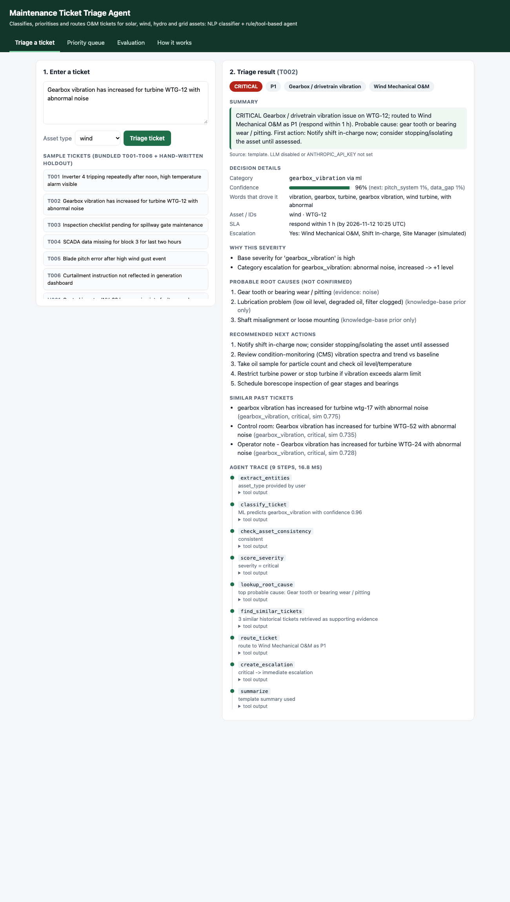

# AI Agent for Maintenance Ticket Prioritization

**Greenko Group – Project Assignment Set 4 (Case Study 04)**

A ticket triage system for renewable-energy O&M. It reads a free-text maintenance ticket and returns its **category, severity, probable root cause, next actions, owning team, priority and SLA**, with a step-by-step trace that explains every decision.

- **Live app:** `<RAILWAY_URL>` (UI at `/`, API docs at `/docs`)
- **Stack:** Python · scikit-learn · FastAPI · HTML/CSS/JS · optional Claude LLM summary · Railway



---

## 1. Problem

Field technicians and SCADA operators raise maintenance tickets as short free text, for example *"Gearbox vibration has increased for turbine WTG-12 with abnormal noise"*. Someone in the control room has to read every ticket and decide what it is, how urgent it is, who owns it and what to do first. When this is done by hand it is slow and inconsistent. The costly failure is **under-triage**: a gearbox about to fail, or a fire, sits in the queue as "medium".

| | |
|---|---|
| **Intended user** | O&M control-room operator / shift in-charge at a solar, wind, hydro or grid site |
| **Input** | Ticket text (required) + asset type (optional: solar / wind / hydro / grid; inferred if missing) |
| **Output** | Category, severity (low/medium/high/critical), priority P1–P4, team, SLA, ranked probable root causes, next actions, similar past tickets, human-review flag, agent trace, short summary |
| **Success** | High category accuracy, **near-zero under-triage of critical tickets**, uncertain tickets flagged for a human rather than silently misrouted, every decision explainable |

**Included:** classifier, severity scoring, root-cause lookup, routing/SLA, escalation, agent trace, optional LLM summary, REST API, web UI, evaluation, tests, Railway config.
**Not included:** real CMMS/SCADA integration (escalation is simulated), real historical tickets, user authentication.

---

## 2. Solution flow

```
ticket text + asset type
   │
   ├─ 1 extract_entities ........ clean text, expand abbreviations (WTG, inv, vib), find asset IDs (WTG-12, Inverter 4),
   │                              infer asset type if missing
   ├─ 2 classify_ticket ......... TF-IDF (word + char n-grams) → Logistic Regression → category + confidence
   │      └─ decision: confidence < 0.45 → 3 keyword_rules_check (second opinion);
   │                   rules pick a class in the ML top-3 → switch; otherwise → flag for human review
   ├─ 4 check_asset_consistency . e.g. "gearbox" on a solar asset → flag for human review
   ├─ 5 score_severity .......... auditable rules; the ML severity model may only RAISE the level
   ├─ 6 lookup_root_cause ....... rank knowledge-base causes by evidence words found in the ticket
   ├─ 7 find_similar_tickets .... nearest historical tickets (TF-IDF cosine) as supporting evidence
   ├─ 8 route_ticket ............ team, priority, SLA, next actions
   ├─ 9 create_escalation ....... only if critical (simulated on-call page)
   └─10 summarize ............... optional LLM rewrites the verified facts; template fallback
   ▼
JSON response (POST /api/triage)  →  web UI
```

### What is ML, what is rules, what is GenAI

| Part | Method | Why |
|---|---|---|
| Category | **ML**: TF-IDF + Logistic Regression | Handles varied wording, typos and synonyms better than keywords (see results) |
| Severity | **Rules**, plus an ML model that can only raise the level | Severity decides who gets woken up, so it must be auditable. The ML cross-check catches cases the rules miss |
| Root cause, routing, SLA | **Knowledge base + rules** | Mirrors a CMMS failure-code catalogue and escalation matrix |
| Summary | **LLM (optional)** | Turns computed facts into 2–3 readable sentences. It never decides anything |

**Is it an agent?** It is a **deterministic, rule/tool-based agent**, which is what the brief asks for. A controller calls 10 tools and makes explicit decisions based on their outputs: the confidence gate, the rules second opinion, the consistency check and conditional escalation. It is **not** an autonomous LLM agent, because the LLM does not choose tools.
**Is there RAG?** **No.** The "similar tickets" step is a nearest-neighbour lookup over past tickets shown as evidence. Its output is not fed to an LLM to generate text.

---

## 3. Data

| File | Rows | Use |
|---|---:|---|
| `data/maintenance_tickets.csv` | 6 | Bundled dataset (one ticket per original category). Used in training **and** as a sanity check |
| `data/synthetic_tickets.csv` | 350 | Generated by `scripts/generate_dataset.py` (seed 42) from 70 domain templates × 5 variants |
| `data/holdout_handwritten.csv` | 36 | Hand-written in a different style (4 per category). **Never used for training** |

**Why synthetic data:** 6 tickets (one per class) cannot train or evaluate a classifier. The generator adds randomised asset IDs, prefixes and suffixes ("Shift log:", "pls check"), abbreviations, typos, lowercase text and **confuser tickets** (e.g. smoke from an inverter is labelled `safety_hazard`, not `inverter_thermal`).

**Categories (9):** the 6 original categories plus `transformer_fault`, `safety_hazard` and `module_soiling`, which are common O&M ticket types at Greenko-style sites.

**Preprocessing:** lowercase, expand field abbreviations (`WTG→wind turbine`, `vib→vibration`, `trf→transformer`), strip symbols, add the asset type as a token (`asset_wind`), extract asset IDs, durations and measurements with regex. Rows with empty text are dropped and duplicates removed. Missing asset types become `unknown` or are inferred from words such as *turbine, inverter, spillway*. There is no date handling, because the tickets have no timestamps.

**Assumptions:** labels reflect a reasonable O&M engineer's judgement (mine); severity levels map to SLAs of 1 h / 4 h / 24 h / 72 h; team names are illustrative.

---

## 4. Model

**Task:** multi-class **text classification** for category (9 classes) plus ordinal **severity scoring** (4 levels). It is classification, not regression, because the outputs are discrete labels that route to a team.

**Chosen model:** TF-IDF features → Logistic Regression (`backend/classifier.py`).
- Works well with a few hundred short texts, trains in under a second, and runs on a CPU-only Railway container.
- Gives probabilities, which the agent uses for its confidence gate.
- Explainable: the UI shows the words that pushed the prediction (e.g. *vibration, gearbox, abnormal*).

**Baseline:** keyword rules (count knowledge-base keywords per category).

**Key hyperparameters**
| Setting | Value | Effect in plain words |
|---|---|---|
| Word n-grams | (1, 2) | Uses single words and two-word phrases. "Abnormal noise" or "data missing" mean more than either word alone |
| Char n-grams | (3, 5) | Looks at word pieces, so "vib", "vibraton" (typo) and "vibration" still match. Improved grouped-CV accuracy from 0.58 to 0.67 |
| `C` (regularisation) | 5.0 | How closely the model fits the training words. Higher = trusts rare words more. Swept 0.5–20: results within ±0.01, so the model is not sensitive to it |
| `class_weight` | balanced | Gives every category equal importance even if one has more examples |
| Confidence threshold | 0.45 / 0.30 | Below 0.45 the agent asks the rules for a second opinion; below 0.30 a human must confirm |

**What I compared:** keyword rules vs word-only TF-IDF vs word+char TF-IDF; a `C` sweep; rules severity vs ML severity vs the conservative combination. I did not try transformers/BERT. With a few hundred synthetic tickets it would likely overfit, and it would make deployment heavier. It is listed as a next step.

---

## 5. Evaluation (`python scripts/evaluate.py` → `reports/`)

**Validation design.** Synthetic tickets share templates, so a random split would leak near-duplicates into the test set. I used **StratifiedGroupKFold grouped by template**: each test fold contains only templates the model never saw. The **hand-written holdout** is the main test on new data. There is no time ordering in this data, so a chronological split does not apply.

### Category
| Test | Keyword-rules baseline | TF-IDF + LR | Agent (ML + rules fallback) |
|---|---:|---:|---:|
| Grouped 5-fold CV on synthetic (accuracy) | 0.949* | 0.666 ± 0.119 | – |
| Bundled 6 tickets (model trained on synthetic only) | 1.00 | 1.00 | 1.00 |
| **Hand-written holdout, 36 (accuracy)** | 0.778 | 0.861 | **0.972** |

\* The keyword list and the templates were written by the same person, so the rules "know" the template words. That is why rules look strong on synthetic data but drop to 0.78 on independently worded tickets. The ML CV score is low because each fold hides 1–2 of only ~8 templates per category, which is a hard extrapolation test. On real tickets the ML model generalises better than the rules (0.86 vs 0.78), and **combining them is best (0.97)**.

### Severity
| Test | Accuracy | Under-triage | Critical recall |
|---|---:|---:|---:|
| Rules on 350 synthetic (rules not tuned on these) | 0.911 | 0.017 | 0.989 |
| ML-severity baseline on holdout | 0.806 | 0.111 | 0.727 |
| Rules **v1** on holdout | 0.750 | 0.194 | 0.727 |
| Rules **v2** on holdout (after error analysis) | 1.000† | 0.000† | 1.000† |
| **Agent end-to-end on holdout** (v2 + ML can only raise) | **0.944**† | **0.000**† | **1.000**† |

† **Honest caveat:** v1 missed critical tickets phrased differently from mine ("high iron content in gearbox oil", "blade not reaching 90° after cyclone warning"). I added domain rules for these (metal/iron in oil, pitch cannot feather, expired statutory certificate, export above an SLDC limit, "slightly"/"no trip yet" downgrades) and the "ML can only raise severity" safeguard. Because those changes were informed by holdout errors, **the v2 holdout numbers are optimistic**. The synthetic row (0.91 / 1.7% under-triage) is the fairer estimate. A new engineer-labelled test set is needed.

**Under-triage** = predicted severity lower than the true severity. This is the metric that matters most for safety, so the system is designed to prefer over-triage.

### Error example (shown in the UI)
- **H016** *"Weather station irradiance sensor not sending readings"*: true `data_gap`, predicted `inverter_thermal` with **confidence 0.23**. The words "irradiance/sensor" never appear in the training data. **The agent flagged it for human review**, so the safety net worked: a low-confidence ticket is not silently misrouted.
- **H003** *"inverter 9 fans making noise, temp slightly above normal but no trip yet"*: the rules said medium, but the ML model raised it to high. This is an intentional over-triage, the trade-off of "never under-triage".

Full results: [`reports/evaluation.md`](reports/evaluation.md) · per-ticket predictions: [`reports/holdout_predictions.csv`](reports/holdout_predictions.csv)

---

## 6. GenAI layer (`backend/llm.py`)

- **What it does:** writes a 2–3 sentence summary for the operator. It does **not** classify, score or route.
- **Model:** Anthropic Claude (`claude-opus-5-5` by default, overridable with `LLM_MODEL`) via the official `anthropic` SDK at low effort. Chosen for summary quality and simple SDK integration. The output is short, so cost per ticket is small.
- **Input sent:** only verified, computed facts (category, severity + reasons, top 2 probable causes, team, SLA, first actions, review flag). No API keys or internal data.
- **Prompt rules:** use only facts in the JSON; call causes "probable"; do not invent readings or names; mention the human-review flag.
- **Safeguards:** key only from the `ANTHROPIC_API_KEY` env var (never in code or the repo); 20 s timeout and 1 retry; if the key is missing, the API errors or the model declines → deterministic **template summary**; output validated (non-empty, length limit, severity label enforced). The UI always shows whether the summary came from the LLM or the template.
- **Without a key the whole app works.** Every metric above was produced without the LLM.

---

## 7. API

| Method | Path | Purpose |
|---|---|---|
| POST | `/api/triage` | Triage one ticket |
| GET | `/api/queue` | Triage all 42 sample tickets → prioritised work queue |
| GET | `/api/metrics` | Evaluation results |
| GET | `/api/tickets` | Sample tickets |
| GET | `/api/categories` | Knowledge base summary (teams, SLAs) |
| GET | `/api/health` | Health check (used by Railway) |
| GET | `/docs` | Interactive OpenAPI docs |

```bash
curl -X POST http://localhost:8000/api/triage \
  -H "Content-Type: application/json" \
  -d '{"text": "Gearbox vibration has increased for turbine WTG-12 with abnormal noise", "asset_type": "wind"}'
```
Response (abridged):
```json
{"category": {"id": "gearbox_vibration", "confidence": 0.957, "method": "ml"},
 "severity": {"severity": "critical", "reasons": ["Base severity for 'gearbox_vibration' is high",
              "Category escalation for gearbox_vibration: abnormal noise, increased -> +1 level"]},
 "routing": {"team": "Wind Mechanical O&M", "priority": "P1", "sla_hours": 1, "next_actions": ["..."]},
 "root_cause": {"probable_causes": [{"cause": "Gear tooth or bearing wear / pitting", "matched_evidence": ["noise"]}]},
 "escalation": {"escalated": true}, "needs_human_review": false, "trace": ["... 9 steps ..."]}
```
Input validation: text 5–2000 characters, asset type restricted to solar/wind/hydro/grid → HTTP 422 otherwise.

---

## 8. Run locally

```bash
python3.12 -m venv .venv && source .venv/bin/activate
pip install -r requirements.txt
python scripts/generate_dataset.py      # optional - data/synthetic_tickets.csv is committed
python scripts/evaluate.py              # writes reports/metrics.json + evaluation.md
uvicorn backend.app:app --reload        # open http://localhost:8000
python -m pytest -q                     # 9 tests
```
Optional LLM summary: `export ANTHROPIC_API_KEY=...` before starting (see `.env.example`).

Demo shortcuts: `/?ticket=T002` (critical gearbox), `/?ticket=H016` (low confidence → human review), `/#queue`, `/#eval`.

## 9. Deploy to Railway

1. Push this repo to GitHub.
2. Railway → **New Project → Deploy from GitHub repo** → select the repo.
3. Railway detects Python (`requirements.txt`, `.python-version` = 3.12) and starts the app with `railway.json` / `Procfile`: `uvicorn backend.app:app --host 0.0.0.0 --port $PORT`. Health check: `/api/health`.
4. Settings → Networking → **Generate Domain** to get the public URL.
5. (Optional) Variables → add `ANTHROPIC_API_KEY` to enable LLM summaries.

The model trains at startup in about 1 second if no saved model exists, so no model file has to be committed.

---

## 10. Limitations and production gaps

- **Synthetic, self-labelled data.** All training and holdout labels were written by me. Real CMMS tickets with engineer-assigned labels are the biggest missing piece. Expect lower accuracy on real data.
- **Severity holdout numbers are optimistic** (rules revised after holdout error analysis; see §5).
- **Unknown vocabulary:** words never seen in training (e.g. "irradiance sensor") give low confidence. The system flags these for review but cannot classify them correctly.
- **One category per ticket.** A ticket describing two problems gets one label.
- **English only.** Field tickets may mix Hindi/Telugu words.
- **Escalation is simulated.** There is no CMMS, SAP PM, SMS or paging integration, and no authentication or rate limiting on the API.
- **No feedback loop.** Operator corrections are not yet captured for retraining.

**Next steps for production:** train on real historical tickets with a time-based split (train on older tickets, test on newer); capture operator overrides as new labels; compare against a small fine-tuned transformer; add authentication and audit logging; integrate with the CMMS work-order API; monitor confidence drift and under-triage rate weekly.

---

## 11. Repository map

```
backend/
  app.py              FastAPI endpoints, serves the UI
  agent.py            Agent controller + 10 tools + decision trace
  classifier.py       TF-IDF + Logistic Regression, keyword baseline, explanations
  severity.py         Rule-based severity scoring
  knowledge_base.py   Categories, root causes, actions, teams, SLAs, severity terms
  preprocessing.py    Text cleaning, abbreviation expansion, entity extraction
  llm.py              Optional Claude summary with template fallback
frontend/index.html   Single-page UI (triage, priority queue, evaluation, how it works)
scripts/
  generate_dataset.py Synthetic data generator (seeded)
  evaluate.py         Grouped CV, holdout tests, baselines, confusion matrix → reports/
data/                 Bundled, synthetic and hand-written holdout tickets
reports/              metrics.json, evaluation.md, holdout_predictions.csv
tests/test_agent.py   9 tests (bundled tickets, safety escalation, API, LLM fallback ...)
docs/screenshots/     UI screenshots (triage result, review flag, queue, evaluation)
Procfile, railway.json, .python-version   Deployment
```

## 12. Use of AI tools

I used an AI coding assistant (Claude Code) to help scaffold the code, data templates and documentation. I chose the overall design (ML for category, rules for severity, LLM only for summaries), reviewed the generated code, ran the evaluation and checked the error cases myself. The decision to report the v1 → v2 severity revision openly came from that review.

---

*Original task brief:* see `candidate_task.md`, `evaluation_rubric.md`, `submission_instructions.md`, `case_study.html`.
